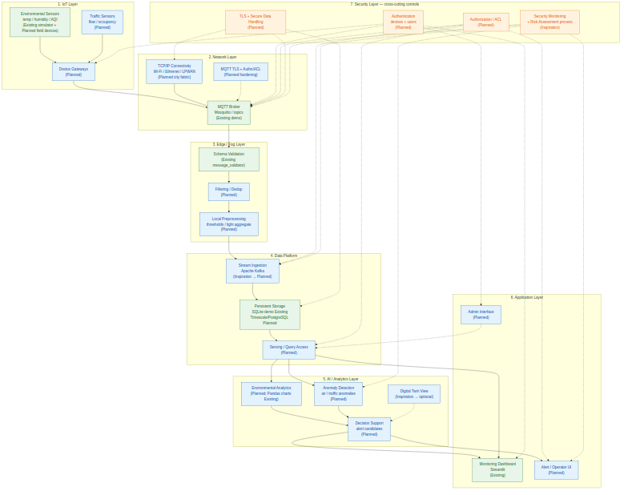

# Smart City Multilayer Architecture Design

Conceptual architecture assignment for a Smart City platform with seven layers:

1. IoT Layer  
2. Network Layer  
3. Edge/Fog Layer  
4. Data Platform  
5. AI/Analytics Layer  
6. Application Layer  
7. Security Layer (cross-cutting)

**Branch:** `smart-city-architecture` (from `master`)  
**Repository baseline:** Smart-City-IoT-Monitoring (Python, MQTT, SQLite, Streamlit)

> This branch is about **architecture design**, not a full city platform implementation.  
> Do not assume Kafka, AI anomaly services, TLS/auth, traffic sensors, or admin UI are already deployed.

---

## Overview

Assignment №1 delivers a target multilayer Smart City architecture inspired by the existing educational MQTT environmental monitoring system.

Existing demo path:

```text
Sensor Simulator → MQTT → Validator/Subscriber → SQLite → Streamlit Dashboard
```

Target conceptual path:

```text
Sensors → Network → Edge/Fog → Data Platform → AI/Analytics → Applications
                 + Security controls across all layers
```

---

## Problem Description

A Smart City needs more than sensor charts. It needs a managed architecture for:

- collecting environmental and traffic data;
- secure network delivery;
- edge processing;
- a scalable data platform;
- analytics and anomaly detection;
- application interfaces for operators;
- a cross-cutting security model.

The goal of this branch is to design and justify that architecture.

---

## Architecture Concepts

| Concept | Meaning |
|---|---|
| Layered architecture | Clear separation of concerns across 7 layers |
| Existing | Already present in the MQTT demo on `master` |
| Inspiration | Ideas from other branches (`kafka-pipeline`, `digital-twin`, `security-risk-assessment`) |
| Planned / Conceptual | Target component that is not implemented yet |
| Cross-cutting security | Security controls that apply across all layers |
| Data flow | Sensors → … → Applications |

Key technologies in the target model:

- IoT sensors + gateways  
- MQTT / TCP/IP  
- Edge validation and preprocessing  
- Kafka + persistent storage  
- Analytics / anomaly detection / decision support  
- Monitoring + admin/alert UIs  
- Authn, Authz, TLS, secure data handling  

---

## Architecture Diagram

Source and exports:

- `architecture.mmd` — Mermaid source  
- `architecture.svg` — vector image  
- `architecture.png` — raster preview  

The diagram shows:

- all seven layers;
- main components;
- primary data-flow arrows;
- dashed security-control links;
- Existing vs Planned distinction via node labels/colors.

Embedded preview:



---

## Example Output

Example conceptual scenario output (alert path):

```text
[IoT]      Kentron air_quality reading = 118
[Network]  MQTT topic delivery OK
[Edge]     schema valid; threshold flag = true
[Data]     event ingested + stored
[AI]       anomaly_score high vs district baseline
[App]      ALERT: Abnormal air pollution in Kentron
[Security] publisher authenticated; operator authorized; TLS enabled (target design)
```

Diagram-level example output is the layered chart in `architecture.png`.

---

## Explanation of Output

- High pollution starts as an IoT measurement, not as a dashboard-only event.  
- Edge validation prevents malformed data from polluting analytics.  
- Data Platform keeps the event available for history and fan-out.  
- AI/Analytics decides whether the spike is an anomaly.  
- Application Layer presents the alert to a human operator.  
- Security explains why untrusted publishers/users should not be able to forge or silently view such alerts in the target architecture.

The existing MQTT demo can show environmental charts today, but the full alert/AI/Kafka/security path above is **conceptual**.

---

## How to View the Diagram

No build or compilation step is required for this architecture assignment.

```bash
cd /home/lyudmila/Desktop/tt

# Raster
xdg-open architecture.png

# Vector
xdg-open architecture.svg

# Source
less architecture.mmd
```

You can also paste `architecture.mmd` into any Mermaid live editor or Markdown preview that supports Mermaid.

Related report:

```bash
less architecture.md
```

---

## Technologies

### Existing in the MQTT baseline (`master`)

| Technology | Role |
|---|---|
| Python sensor simulator | IoT demo telemetry |
| MQTT + Mosquitto | Network messaging |
| `message_validator.py` | Edge-like validation prototype |
| SQLite | Demo persistence |
| Streamlit + Pandas + Plotly | Monitoring UI / simple charts |

### Planned / conceptual for the target architecture

| Technology | Role |
|---|---|
| Traffic sensors + gateways | Broader IoT coverage |
| MQTT TLS + authentication + ACL | Network security hardening |
| Fog/edge workers | Filtering and local preprocessing |
| Apache Kafka | Data platform ingestion |
| PostgreSQL / Timescale (or similar) | City-scale storage |
| Anomaly detection + decision support | AI/Analytics |
| Admin / Alert UI | Application operations |
| Cross-layer security monitoring | Security operations |

### Inspiration from other branches

| Branch | Inspiration |
|---|---|
| `kafka-pipeline` | Streaming ingestion |
| `digital-twin` | Twin/analytics presentation |
| `security-risk-assessment` | Threat/risk-oriented security thinking |

---

## Limitations

1. This is an architecture design package, not a deployed Smart City platform.  
2. Proposed components must not be described as already implemented.  
3. Current demo broker config remains educational (`allow_anonymous true` on `master`).  
4. Diagram exports are helpers for presentation; the authoritative structure is `architecture.mmd` + `architecture.md`.  
5. No claim of penetration testing or production readiness.

---

## Repository files for this assignment

```text
architecture.md      # full architecture report
architecture.mmd     # Mermaid diagram source
architecture.svg     # vector export
architecture.png     # PNG preview
README.md            # this file
```

Optional: the original MQTT monitoring system from `master` can still be explored for hands-on IoT context, but it is not the deliverable of Assignment №1.
